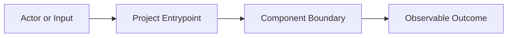
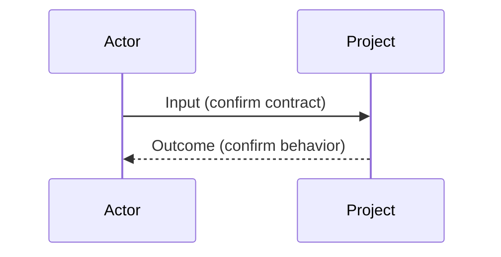

# Architecture

## Project Purpose
Exact prime succession through reusable arithmetic state, with reproducible numerical physics applications.

## Authoring Scope and Evidence
Project: Primeward. This is an initial authoring scaffold, not an implementation attestation.

Describe the configured project from purpose to architecture to implementation depth. Start with the whole product: its users, problem, outcomes, and boundaries; then explain the system and its components, interfaces, state, operations, security, and proof. Ground factual prose in the repository's config, README/product documentation, source paths and symbols, contracts, and tests. Distinguish implemented behavior, intended behavior, assumptions, and unresolved gaps. A narrow task changes the relevant part of this whole-project account; it must not replace project-wide identity with the latest task, release workflow, or tooling. Record task-specific scope and evidence in the current change's governance record. Templates and declared capabilities are authoring/proof obligations, not evidence that a runtime guarantee exists. Preserve authored prose during generated refreshes. If configured metadata and explicit project-level sections are absent, leave project identity unknown and ask for or author grounded context rather than promoting an arbitrary legacy/task line.

Use the seeded context below as a starting point to verify against repository sources. Replace example diagrams, suggested controls, targets, tables, and blank fields with source-grounded prose; mark non-applicable topics with a reason. Do not adopt a store, queue, server, CI provider, replay guarantee, or service level merely because it appears in a template.

## Direction
A Python core for certified arithmetic and independent applications for thermodynamics, spectral recovery, scattering, wave transport, inverse quantum spectra, and finite spectral models.

## System Overview
Explain how Primeward's main components fulfill the project purpose above.
Start at the whole-system boundary, then trace the primary workflows down to
implementation paths and symbols. Explain why the boundaries exist and which
tradeoffs or limitations they create. Link to evidence for each factual claim.

## Current Facts
- Runtime/languages: Python
- Detected surfaces/framework hints: cli, library
- Product type: service_or_library

## Architecture Map
Document the actual component boundaries and source paths in this repository.
Do not infer a directory layout from the project's language or product type.

## Data Flows
Trace real inputs through the owning components to observable outcomes.
Name each source path or symbol, state owner if any, and failure boundary;
distinguish verified behavior from proposed changes and unresolved questions.

## Strongest Existing Primitives
- Define the strongest existing primitives in the codebase (e.g., helper utilities, base controllers, data access layers).

## Topology
Illustrative shape only; replace with the observed whole-project topology.

## Store Boundaries
Describe state ownership and consistency only where supported by source evidence;
if the project has no persistent store, say so and identify the relevant sources.

## Happy Path Sequence
Illustrative shape only; replace with a source-grounded end-to-end workflow.

## Error Path
Trace an actual failure from its origin to the caller-visible result and recovery.
Do not assume database transactions, automatic retries, or side-effect rollback.

## Execution Path
- Ingress parse + validation:
- Policy/interlock checks:
- Core execution + persistence:
- Verification and artifact emission:

## Concurrency and Runtime Model
- Execution model:
- Isolation boundaries:
- Backpressure strategy:
- Shared state synchronization:

## Deployment Topology
- Runtime units:
- Region/zone model:
- Rollout strategy (blue/green/canary):
- Rollback trigger and blast-radius scope:

## Data and Contracts
- Inbound contracts (CLI/API/events):
- Outbound dependencies (datastores/queues/external APIs):
- Data ownership boundaries:
- Schema evolution + migration policy:

## Component Responsibility Matrix
| Component/Path | Responsibility | Owns State | Calls | Must Not Do | Failure Boundary |
|---|---|---|---|---|---|
| Entrypoint | Parse, authenticate, and normalize input | Request context | Core boundary | Apply domain mutations directly | Typed input error |
| Core/domain | Enforce invariants and execute the workflow | Domain state | Interfaces and stores | Bypass policy or validation | Transaction/error result |
| Persistence adapter | Commit and retrieve canonical state | Store representation | Database/queue | Become a second source of truth | Retryable storage error |
| Verification | Produce evidence for promotion | Proof artifacts | Test/runtime surfaces | Declare success without checks | Failed/unsupported proof |

## State and Data Lifecycle
| Data/Artifact | Created By | Source of Truth | Retention | Consistency | Recovery |
|---|---|---|---|---|---|
| User/domain state | | | | | |
| Derived/read state | | | | | |
| Audit/provenance evidence | | | | | |
| Temporary execution state | | | | | |

## Failure Containment
- For each boundary, describe what can fail and which side effects remain.
- Cite the code and tests for rejection, retry, rollback, or compensation claims.
- Record unsupported guarantees and unresolved recovery gaps explicitly.
- Distinguish product runtime failures from delivery/proof failures in
  [VALIDATION.md](./VALIDATION.md).

## Change Propagation Checklist
- [ ] Component ownership remains singular and explicit.
- [ ] Inbound/outbound calls and data flow are still represented.
- [ ] New state has an owner, lifecycle, and migration path.
- [ ] Failure containment and rollback behavior were re-evaluated.
- [ ] Architecture and interface diagrams still describe the implementation.

## ADR Register
| ADR | Title | Status | Rationale | Date |
|---|---|---|---|---|
| ADR-001 | Initial topology choice | Proposed | Define first stable architecture | YYYY-MM-DD |

## Delivery Plan (first 3 slices)
- Slice 1 (ship first):
- Slice 2:
- Slice 3:

## Risks and Mitigations
| Risk | Likelihood | Impact | Mitigation |
|---|---|---|---|
| Contract drift across components | Medium | High | Spec + schema checks in CI |
| Runtime saturation under peak load | Medium | High | Capacity model + load tests |
