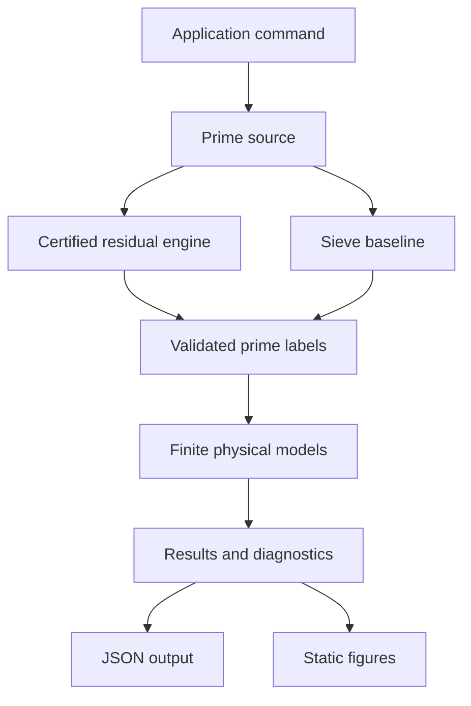

# Architecture

## Direction

Primeward separates exact arithmetic research from the finite physics models that consume it.
The core remains useful with python-flint alone; scientific dependencies are optional.
The implementation exposes costs and error diagnostics rather than asserting a new fast successor algorithm.

## Current Facts

The analytic engines live in `prime_successor/analytic.py`, `optimized.py` and `fast_analytic.py`.
The exact sieve/scalar baselines live in `prime_successor/engine.py`.
Experiments compare independent engines and charge initialization separately from subsequent advances.
Eight application modules now share prime generation, result envelopes and a command runner.

## Topology

## Execution Path

The runner validates options, obtains a prime list, invokes the selected model and records the source.
Each module's demo returns model parameters, data and explicit pass/fail checks.
Strict JSON serialization and optional plotting consume that result without recomputing the model.
Spectral recovery can also accept interval observations directly through its Python API.
The inverse module performs fitting first, then independent grid and box calculations with fixed coefficients.

## Concurrency and Runtime Model

Application runs are sequential because the Arb precision context is process-global.
Seeded controls own a local NumPy generator and do not rely on global random state.
Core and application state are ordinary local objects; no queue or distributed worker is involved.
One claimed Decapod worktree has one repository writer; independent reviewers do not mutate that checkout.

## Deployment Topology

The product is a local Python package and command line, with no hosted service or database.
Optional NumPy, SciPy and Matplotlib dependencies support eigensolves, fitting and plots.
GitHub Actions runs the Python suite and examples explicitly alongside Decapod CI governance.
A reviewed local runtime contract binds native readiness to measured interpreter, libraries and dependency archive.
The proof entry point extracts that measured archive into owned temporary storage; it performs no network install.
The contributor provisioner in `applications/tools/` rebuilds this layout from an installed trusted venv.
It emits closure hashes and a suggested contract for review, without editing governance.

## Data and Contracts

Integer successor certificates and Arb intervals provide their stated enclosing guarantees.
Other observables use floating-point arithmetic with independently checked identities and refinement errors.
The result schema and status semantics are described in INTERFACES.md and the application guide.
Product output files are separate from CLI-owned Decapod sessions, stores and proof receipts.

## Delivery Plan

Install the core or optional application dependencies using the documented package commands.
Run individual models, inspect JSON checks, and generate plots only when requested.
Review source, authored specifications and proof declarations, then checkpoint and validate the candidate.
Publish the validated source and recorded examples to the existing repository.

## Risks and Mitigations

Precision requirements can dominate certified prime generation; explicit sieve selection supports larger models.
Noise limits spectral inference; complete interval subtraction prevents overstated resolution.
Finite-grid inverse fits can overfit discretization; finer grids and larger boxes assess the fixed potential.
Long barrier chains can underflow transmission; log transmission and flux errors remain explicit.
Finite cutoffs in orbit sums and scattering are reported and do not imply asymptotic theorems.

## Record Experiment Execution

`experiments/record_successor.py` separates compact Arb resource analysis from an actual bounded constructor probe. A fresh subprocess owns each numerical case, with explicit time and memory limits. The GitHub workflow has independent target and calibration jobs and retains JSON/Markdown artifacts. The existing physics modules and prime engines remain unchanged.

<!-- decapod:codebase-attestation:start -->

## Codebase Attestation

- Repository signal fingerprint: `3ff49dc88737ecb33f7ddd2f6454d77a62e617c2d8995a23f7342345ab147643`
- Significant implementation surfaces: `.github/` (2 files), `README.md/` (1 files), `applications/` (17 files), `experiments/` (5 files), `prime_successor/` (6 files), `pyproject.toml/` (1 files), `requirements.txt/` (1 files), `tests/` (9 files)
- Refreshed from the current codebase by `decapod rpc --op specs.refresh`
<!-- decapod:codebase-attestation:end -->
