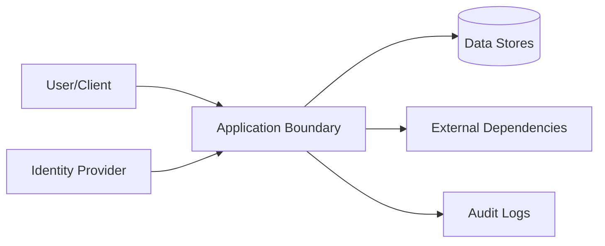

# Security

## Project Purpose
Exact prime succession through reusable arithmetic state, with reproducible numerical physics applications.

## Authoring Scope and Evidence
Project: Primeward. This is an initial authoring scaffold, not an implementation attestation.

Describe the configured project from purpose to architecture to implementation depth. Start with the whole product: its users, problem, outcomes, and boundaries; then explain the system and its components, interfaces, state, operations, security, and proof. Ground factual prose in the repository's config, README/product documentation, source paths and symbols, contracts, and tests. Distinguish implemented behavior, intended behavior, assumptions, and unresolved gaps. A narrow task changes the relevant part of this whole-project account; it must not replace project-wide identity with the latest task, release workflow, or tooling. Record task-specific scope and evidence in the current change's governance record. Templates and declared capabilities are authoring/proof obligations, not evidence that a runtime guarantee exists. Preserve authored prose during generated refreshes. If configured metadata and explicit project-level sections are absent, leave project identity unknown and ask for or author grounded context rather than promoting an arbitrary legacy/task line.

Use the seeded context below as a starting point to verify against repository sources. Replace example diagrams, suggested controls, targets, tables, and blank fields with source-grounded prose; mark non-applicable topics with a reason. Do not adopt a store, queue, server, CI provider, replay guarantee, or service level merely because it appears in a template.

## Threat Model

## STRIDE Table
| Threat | Surface | Mitigation | Verification |
|---|---|---|---|
| Spoofing | Auth boundary | strong auth + token validation | auth tests |
| Tampering | State mutation APIs | integrity checks + RBAC | integration tests |
| Repudiation | Critical actions | immutable audit logs | log review |
| Information disclosure | Data at rest/in transit | encryption + classification | security scans |
| Denial of service | Hot paths | rate limit + backpressure | load tests |
| Elevation of privilege | Admin interfaces | least privilege + policy checks | authz tests |

## Authentication
- Identity source:
- Token/session lifetime:
- Rotation and revocation:

## Authorization
- Role model:
- Resource-level policy:
- Privilege escalation controls:

## Data Classification
| Data Class | Examples | Storage Rules | Access Rules |
|---|---|---|---|
| Public | docs, non-sensitive metadata | standard | unrestricted |
| Internal | operational telemetry | controlled | team access |
| Sensitive | tokens, PII, secrets | encrypted | least privilege |

## Sensitive Data Handling
- Encryption at rest:
- Encryption in transit:
- Redaction in logs:
- Retention + deletion policy:

## Supply Chain Security
- Recommended scanners: `pip-audit`, `safety`, `bandit`
- Dependency update cadence:
- Signed artifact/provenance strategy:

## Secrets Management
| Secret | Source | Rotation | Consumer |
|---|---|---|---|
| External service auth material | managed runtime configuration | periodic | runtime services |
| Artifact signing material | managed signing service/local secure store | periodic | release pipeline |

## Security Testing
| Test Type | Cadence | Tooling |
|---|---|---|
| SAST | each PR | language linters/scanners |
| Dependency scan | each PR + weekly | supply-chain tools |
| DAST/pentest | scheduled | external/internal |

## Trust-Boundary Inventory
| Boundary | Principal/Input | Authority Granted | Validation | Audit Evidence | Failure Default |
|---|---|---|---|---|---|
| User/agent -> entrypoint | | | | | deny/reject |
| Entrypoint -> core | | | | | deny/reject |
| Core -> persistence | | | | | fail closed/transaction rollback |
| Runtime -> external dependency | | | | | timeout/degrade |

## Agent and Automation Safety
- Prompt/configuration text is treated as untrusted input until evaluated by
  the repository's policy gate.
- Automation must not infer authorization, ownership, or a migration approval
  that is not present in the governed context.
- Sensitive artifacts, credentials, and untrusted attachments are not executed
  or imported as instructions.
- Every privileged mutation has an actor, scope, and durable evidence trail.

## Security Change Review
- [ ] New inputs and outputs are classified.
- [ ] Trust boundaries and privilege changes are documented.
- [ ] Abuse cases cover spoofing, tampering, disclosure, denial of service, and
  privilege escalation as applicable.
- [ ] Secret handling, redaction, retention, and deletion were re-checked.
- [ ] Supply-chain and provenance implications are recorded.

## Compliance and Audit
- Regulatory scope:
- Audit evidence location:
- Exception process:

## Pre-Promotion Security Checklist
- [ ] Threat model updated for changed surfaces.
- [ ] Auth/authz tests pass.
- [ ] Dependency vulnerability scan reviewed.
- [ ] No unresolved critical/high security findings.

## Strongest Security Primitives
Describe the security primitives and security controls implemented in this repository.

## Security Practices
- **Least Privilege**: Ensure minimal access permissions for all subsystems and roles.
- **Input Validation**: Strictly validate all inputs at trust boundaries.
- **Secure Storage**: Encrypt sensitive data at rest and in transit.
